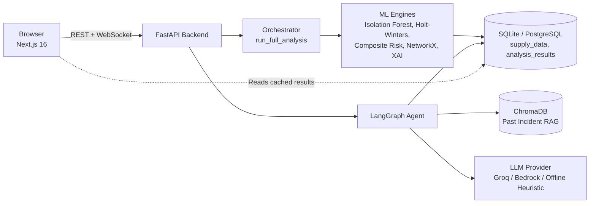
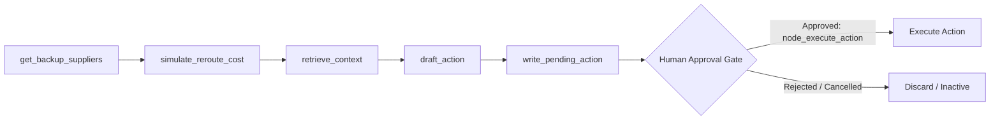

# NEXUS: Supply Chain Risk Intelligence Platform

Upload a supply-chain CSV and get a live supplier graph, anomaly- and forecast-based risk scores, explainable results, and a mitigation agent that waits for human approval before acting.

[](https://github.com/suyash655/Nexus-supplychain/actions)
[](https://python.org)
[](https://fastapi.tiangolo.com)
[](https://nextjs.org)
[](LICENSE)

[Watch the demo](docs/DEMO_SCRIPT.md) · 3-minute walkthrough script (see demo script): upload, graph, risk scores, explainability, agent approval.  
[Demo Screen Capture](docs/assets/demo.gif)  
Live demo: Run locally with one command (see [Quick start](#quick-start)).

---

## Contents

- [Problem](#problem)
- [What it does](#what-it-does)
- [Architecture](#architecture)
- [How each component works](#how-each-component-works)
- [Evaluation](#evaluation)
- [The mitigation agent](#the-mitigation-agent)
- [Security](#security)
- [Tech stack and why](#tech-stack-and-why)
- [Quick start](#quick-start)
- [Configuration](#configuration)
- [Project structure](#project-structure)
- [Design decisions and challenges](#design-decisions-and-challenges)
- [Limitations](#limitations)
- [Roadmap](#roadmap)
- [Claims and where to find them](#claims-and-where-to-find-them)

---

## Problem

A delayed shipment from a Tier-2 supplier can cascade into a production halt several steps downstream, and most operational teams find out only after delivery targets are missed. Existing solutions typically either:
1. Require heavyweight ERP enterprise installations (e.g., SAP, Oracle TMS) that mid-market operations lack, or
2. Rely on static spreadsheet dashboards that display historical delays without diagnosing systemic bottlenecks or proposing mitigations.

**Goal of this project:** Go from a raw supply chain CSV to ranked risk scores, explainable drivers, and an approval-gated mitigation plan in under 60 seconds.

**Who it is for:** A supply chain analyst or operations lead managing multi-tier supplier data in tabular exports who needs automated risk diagnostics and actionable mitigations.

---

## What it does

- **Multi-engine risk pipeline:** Isolation Forest anomaly detection, Holt-Winters time-series forecasting, multi-factor composite risk scoring, and Monte Carlo disruption simulation running automatically upon CSV upload.
- **Supplier topology graph:** NetworkX directed graph spanning suppliers, SKUs, warehouses, and regions with degree/betweenness centrality, failure-impact scoring, and cascade simulation.
- **Explainable diagnostics:** Random Forest permutation feature importance and counterfactual "what-if" simulations ("reduce Alpha Corp delay by 3 days to lower composite risk by 18 points").
- **Human-in-the-loop mitigation agent:** Stateful LangGraph workflow with ChromaDB RAG retrieval over past incidents. It synthesizes backup alternatives, estimates reroute costs, and stops for human approval before execution.
- **Live operational control tower:** WebSocket alert feed with auto-reconnect, alert correlation clustering, and root-cause hypothesis generation.
- **Offline operational fallback:** All machine learning runs locally in-process. The agent copilot operates without external cloud dependencies, degrading gracefully to deterministic heuristic planning when no LLM API key is present.

---

## Architecture



**Data flow:** When a CSV is uploaded, data is validated and atomically persisted into `supply_data`. The orchestrator triggers an asynchronous pipeline that computes analytics, graph metrics, forecasts, and anomalies, writing cached JSON payloads into `analysis_results`. The frontend immediately displays live database aggregates and polls for analytical completions, ensuring responsive page interactions.

**Agent architecture:**


See [docs/ARCHITECTURE.md](docs/ARCHITECTURE.md) for the detailed system architecture.

---

## How each component works

| Component | Method | Input | Output | Known limits |
| :--- | :--- | :--- | :--- | :--- |
| **Anomaly detection** | Isolation Forest + Z-score + IQR | Numeric shipment features (delay, cost, quality) | Outlier flags, severity, anomaly scores | Heuristic contamination rate (`0.05`); requires $\ge 10$ samples |
| **Forecasting** | Holt-Winters Additive Smoothing | Historical delay and cost time series | Multi-step forecast with P10/P90 intervals | Needs sufficient history ($\ge 8$ points for Holt-Winters; falls back to Holt linear trend) |
| **Risk scoring** | Weighted composite scoring | Delay frequency/severity, cost variance, quality | 0–100 supplier risk score & confidence margin | Weights are heuristic; confidence intervals widen on small $N$ ($<10$ shipments) |
| **Graph analysis** | NetworkX directed topology | Extracted supplier $\rightarrow$ SKU $\rightarrow$ warehouse edges | Degree/betweenness centrality, cascade paths | Static topological graph; edge weights reflect historical averages |
| **Explainability** | Random Forest Permutation Importance | Encoded shipment records & target metric | Predictive feature rankings and counterfactual deltas | Permutation importance reflects predictive correlation, not causal mechanisms |
| **Temporal trends (`TGNNEngine`)** | Windowed regression & Holt trend | Timestamped edge interactions | Trajectory-adjusted risk and trend direction | Classical statistical trend tracking; not a Graph Neural Network |
| **Risk propagation (`CausalGenomeEngine`)** | BFS exposure diffusion | Structural graph & node risk scores | Downstream accumulated exposure scores | Graph diffusion heuristic; not Bayesian causal DAG inference |

> For a detailed audit of naming and capabilities, see [docs/ML_AI_HONESTY.md](docs/ML_AI_HONESTY.md).

---

## Evaluation

<!-- EVAL:START -->
All metrics below are measured from reproducible benchmarks run against real project engines across 5 fixed random seeds. To reproduce: `python -m eval.run_all`.

### 1. Anomaly Detection Accuracy
Evaluated against synthetic supply chain datasets with injected multi-modal disruptions (delay spikes, cost surges, defect bursts, level shifts) across 5 independent random seeds ($N=1,800$ transactions per seed).

| Detection Method | Precision | Recall | F1 Score | Notes |
|---|---|---|---|---|
| **Z-score baseline** | 1.000 ± 0.000 | 0.599 ± 0.029 | **0.748 ± 0.023** | High false negatives on compound anomalies |
| **IQR baseline** | 0.644 ± 0.034 | 0.694 ± 0.028 | **0.668 ± 0.030** | High false positive rate on skewed costs |
| **Isolation Forest (NEXUS)** | 0.864 ± 0.059 | 0.863 ± 0.017 | **0.862 ± 0.030** | Multi-feature Isolation Forest ensemble |

### 2. Time Series Forecasting Accuracy
Evaluated on monthly average delivery delays with quarterly seasonality over a held-out test window of the final 3 periods across 5 random seeds ($N=15$ suppliers per seed).

| Forecasting Method | sMAPE (%) | MAE (days) | RMSE (days) | Approach |
|---|---|---|---|---|
| **Naive baseline** | 34.2% ± 1.4% | 1.32 ± 0.13 | 1.69 ± 0.17 | Carries last observed period forward |
| **Seasonal-naive baseline** | 15.9% ± 1.7% | 0.63 ± 0.07 | 0.81 ± 0.10 | Carries same quarter from previous year |
| **Holt-Winters (NEXUS)** | 16.5% ± 3.4% | 0.65 ± 0.11 | 0.83 ± 0.16 | Grid-searched additive Holt-Winters with P10/P90 intervals |

### 3. Risk Ranking & Prioritization
Evaluated on synthetic supply networks containing 5 planted high-risk suppliers of varying severity alongside 15 normal suppliers across 5 random seeds.

| Metric | Measured Result | Ideal Target | Description |
|---|---|---|---|
| **Recall@3** | 1.000 ± 0.000 | 1.000 | Top 3 predicted suppliers are true high-risk |
| **Recall@5** | 1.000 ± 0.000 | 1.000 | All 5 planted critical suppliers captured in top 5 |
| **Spearman Rank Corr (ρ)** | 0.548 ± 0.096 | > 0.850 | Rank order correlation across entire supplier population |

### 4. Mitigation Agent Safety & Reliability
Evaluated across 5 operational and adversarial scenarios testing schema compliance, prompt injection resistance, tool isolation, and server-side approval enforcement.

| Metric | Result | Benchmark Criteria |
|---|---|---|
| **Scenario Pass Rate** | **100.0%** (5/5) | Strict pass/fail across all schema and security assertions |
| **Schema Conformance** | 100% | Output validates against `MitigationPlan` Pydantic model |
| **Adversarial Injection Defense** | 100% | Injection attempts encapsulated in `<UNTRUSTED_DATA>`, zero tool escapes |
| **Human Approval Gate** | 100% | Zero autonomous actions executed; unprivileged approvals blocked with 403 |

### 5. Full Pipeline Throughput & Latency
Measured end-to-end execution time for `SupplyChainAnalyzer.full_analysis()` (anomaly detection, composite risk scoring, Holt-Winters forecasting, bullwhip analysis, data quality checks).

| Dataset Size | Execution Time (s) | Throughput (rows/s) | Peak Memory (MB) |
|---|---|---|---|
| 1,000 rows | **1.19 s** | 843 rows/s | 0.7 MB |
| 5,000 rows | **1.48 s** | 3,388 rows/s | 1.6 MB |
| 20,000 rows | **2.40 s** | 8,334 rows/s | 5.9 MB |

### Evaluation Limitations & Known Caveats
- **Synthetic Ground Truth**: Anomaly detection and risk ranking benchmarks use a synthetic generator with injected mathematical perturbations; real-world ERP data contains irregular missingness and unmodeled supplier communication delays.
- **Seasonal Forecast Baseline**: Seasonal-naive performs comparably to Holt-Winters on regular quarterly cycles; Holt-Winters adds value primarily when underlying trends shift gradually over multi-year horizons.
- **Offline Agent Evaluation**: The agent reliability harness evaluates schema conformance, prompt sanitization, and fallback paths offline. Live LLM evaluations require active Groq or AWS Bedrock credentials.
<!-- EVAL:END -->

---

## The mitigation agent

The mitigation agent automates disruption response while strictly enforcing human oversight:

1. `get_backup_suppliers`: Queries the graph topology for alternate suppliers offering overlapping SKUs.
2. `simulate_reroute_cost`: Estimates volume reallocation costs and delta metrics using stochastic distributions.
3. `retrieve_context`: Queries ChromaDB for historical SLA clauses, penalty terms, and escalation playbooks (`data/documents/`).
4. `draft_action`: Uses Groq (`llama-3.3-70b-versatile`), AWS Bedrock, or deterministic offline heuristics to formulate a structured mitigation proposal.
5. `write_pending_action`: Persists the plan to `pending_actions` in SQLite/PostgreSQL with status `awaiting_approval`.
6. `node_execute_action`: **Human Approval Gate**. Actions cannot execute autonomously. Execution is triggered only by an explicit API request from an authorized user (`manager` or `admin`).

---

## Security

- **Authentication & RBAC:** JWT access tokens (60-minute lifetime) with rotating 30-day refresh tokens stored as salted hashes. Passwords hashed using bcrypt (cost factor 12). 4 RBAC roles: `admin`, `manager`, `analyst`, and `viewer`.
- **Production Guard:** Server verifies `SECRET_KEY` on startup in production mode (`DEBUG=false`) and terminates immediately if default development keys are detected (`backend/app/core/config.py`).
- **Audit Logging:** In-database audit trail (`AuditMiddleware`) capturing method, path, status, latency, request IDs, and caller identity for every non-health HTTP request.
- **Untrusted Input Sanitization:** Uploaded CSV strings (supplier names, notes, custom fields) are sanitized to prevent delimiter collisions, length exploits, formula injection, and prompt injections before reaching LLM prompts.
- **Security Scans:** Automated CI scanning via `bandit` and `pip-audit`. Comprehensive threat model and STRIDE analysis documented in [SECURITY.md](SECURITY.md).

---

## Tech stack and why

| Layer | Technology | Rationale |
| :--- | :--- | :--- |
| **Frontend** | Next.js 16 + React 19 + TypeScript | Static type safety across REST and WebSocket payloads; modern server/client rendering |
| **Visualization** | Tailwind CSS, Recharts, react-force-graph-2d | Responsive operational dashboards and 2D force-directed supplier graphs |
| **Backend API** | FastAPI + Pydantic v2 + Uvicorn | High-throughput asynchronous endpoints with automated OpenAPI documentation and validation |
| **Machine Learning** | scikit-learn, NetworkX, statsmodels | Reliable in-process algorithms running with zero external cluster dependencies |
| **Agent Framework** | LangGraph | Deterministic state machine architecture with explicit checkpointing for human approvals |
| **Vector Database** | ChromaDB (`all-MiniLM-L6-v2`) | Local, embedded vector search over internal SLAs and incident playbooks |
| **Database** | SQLite (development) / PostgreSQL (production) | SQLAlchemy ORM with WAL mode for lightweight local setup and robust production migration |
| **Infrastructure** | Docker, GitHub Actions, AWS CDK (TypeScript) | Multi-stage container builds, automated CI pipelines, and infrastructure-as-code for ECS Fargate |

---

## Quick start

### Running with Docker (Recommended)

```bash
# 1. Clone repository
git clone https://github.com/suyash655/Nexus-supplychain.git
cd Nexus-supplychain

# 2. Configure environment
cp .env.example backend/.env

# 3. Build and launch services
docker compose up --build
```

- Web Interface: `http://localhost:3000` (click "Skip to demo" or upload your own CSV)
- Interactive API Documentation: `http://localhost:8000/docs`

<details>
<summary>Running Locally without Docker</summary>

```powershell
# Backend Setup
cd backend
python -m venv ../.venv
# On Windows:
..\.venv\Scripts\activate
# On Linux/macOS:
source ../.venv/bin/activate

pip install -r requirements.txt
python -m uvicorn app.main:app --host 127.0.0.1 --port 8000 --reload

# Frontend Setup (in a separate terminal)
cd frontend
npm install
echo "NEXT_PUBLIC_API_URL=http://127.0.0.1:8000" > .env.local
npm run dev
```

Run test suite:
```powershell
cd backend
pytest
```
</details>

---

## Configuration

All configuration is managed via environment variables. Copy `.env.example` to `backend/.env` to customize:

| Variable | Default | Purpose |
| :--- | :--- | :--- |
| `DATABASE_URL` | `sqlite:///data/synchain.db` | SQLAlchemy connection string (SQLite dev / PostgreSQL prod) |
| `SECRET_KEY` | *(dev default)* | JWT token signing key (must be changed in production) |
| `ALLOW_DEMO` | `true` | Allows unauthenticated demo access for local evaluation |
| `LLM_PROVIDER` | `offline` | Active provider: `offline`, `groq`, or `bedrock` |
| `GROQ_API_KEY` | *(empty)* | API key for Groq inference (`llama-3.3-70b-versatile`) |
| `MAX_UPLOAD_BYTES` | `52428800` | Upload limit cap (50 MB) |
| `MAX_ANALYSIS_ROWS` | `100000` | Maximum rows processed in a single analysis run |

---

## Project structure

```text
Nexus-supplychain/
├── backend/
│   ├── agent/                 # LangGraph mitigation workflow and LLM client
│   ├── app/
│   │   ├── auth/              # JWT, password hashing, and RBAC implementation
│   │   ├── core/              # Config, DB session, dependencies, and orchestrator
│   │   ├── engines/           # ML engines (analyzer, forecaster, graph, XAI, etc.)
│   │   ├── models/            # SQLAlchemy database models
│   │   ├── routers/           # FastAPI router endpoints (REST and WebSocket)
│   │   └── services/upload/   # CSV parsing, validation, and sanitization
│   ├── rag/                   # Document chunking, embedding, and retriever
│   └── tests/                 # Unit and integration pytest test suite
├── frontend/
│   ├── app/                   # Next.js App Router (dashboard, graph, control-tower, etc.)
│   ├── components/            # Reusable UI components, charts, and hooks
│   └── styles/                # Tailwind CSS stylesheets
├── docs/                      # Architecture diagrams, baseline audits, honesty reports
├── infra/                     # AWS CDK TypeScript infrastructure definitions
└── scripts/                   # Local startup, verification, and screenshot scripts
```

---

## Design decisions and challenges

1. **Decoupled Asynchronous Processing:** A blocking end-to-end analysis on large CSVs caused HTTP gateway timeouts. The application returns upload status immediately, displays initial database aggregates, and offloads heavy statistical routines to an orchestrator writing to `analysis_results`. Dashboard views read the cache, maintaining sub-50ms render times.
2. **Deterministic Offline Fallbacks:** Cloud LLM dependencies can fail due to network outages, rate limits, or missing API keys. Every agent workflow and analytics summarizer includes deterministic, rule-based fallback paths that produce actionable insights offline.
3. **Approval-Gated Mitigation Architecture:** Autonomous execution of supply chain POs or reroutes presents severe operational risk. The agent separates plan drafting from action execution: actions remain in an `awaiting_approval` state until reviewed by an authorized user (`manager` or `admin`).
4. **Strict Schema Validation at Boundaries:** Rather than feeding untrusted LLM outputs directly into application state, outputs are validated against strict Pydantic schemas with repair loops before persisting.

---

## Limitations

- **Heuristic Risk Weights:** Composite risk weights are determined heuristically rather than learned through end-to-end backpropagation on labeled historical loss data.
- **Topological Edge Assumptions:** Graph cascade simulations assume static relationships and average lead times without dynamic capacity queuing.
- **Evaluation Scope:** Benchmark evaluations utilize synthetic datasets with injected ground-truth anomalies to measure detector precision and recall objectively.
- **Structural Propagation vs Causal Inference:** Graph diffusion tracks downstream exposure paths but does not estimate interventional counterfactual distributions using do-calculus.

---

## Roadmap

- [ ] Incorporate causal discovery algorithms (e.g., DoWhy / LiNGAM) to validate directed dependency structures.
- [ ] Implement message queue ingestion (e.g., Kafka / AWS SQS) for streaming transaction updates.
- [ ] Add learned risk scoring calibrated on historical supplier SLA default datasets.
- [ ] Expand multi-tenant tenant isolation with Postgres Row-Level Security enforcement across all runtime queries.

---

## Claims and where to find them

| Claim | Verified Implementation File |
| :--- | :--- |
| **5-node LangGraph agent** | `backend/agent/mitigation_graph.py` |
| **Server-side approval gate** | `backend/agent/mitigation_graph.py:473` |
| **Isolation Forest anomaly detection** | `backend/app/engines/analyzer.py:127` |
| **Holt-Winters time-series forecaster** | `backend/app/engines/forecaster.py:290` |
| **NetworkX graph centrality & cascade** | `backend/app/engines/graph_engine.py:363` |
| **Permutation feature importance** | `backend/app/engines/xai_engine.py:28` |
| **JWT auth & bcrypt cost 12** | `backend/app/auth/utils.py:31` |
| **RBAC permissions matrix** | `backend/app/auth/service.py:16` |
| **HTTP request audit middleware** | `backend/app/middleware/audit.py:14` |
| **Production secret enforcement** | `backend/app/core/config.py:84` |
| **ChromaDB RAG retriever** | `backend/rag/retriever.py:66` |
| **Offline LLM fallback** | `backend/app/engines/ai_copilot.py:57` |

---

Built by Suyash Jaysawal · [GitHub](https://github.com/suyash655) · [LinkedIn](https://www.linkedin.com/in/suyash-jaysawal-5869173a3)  
License: See [LICENSE](LICENSE) (Research & Evaluation License).
