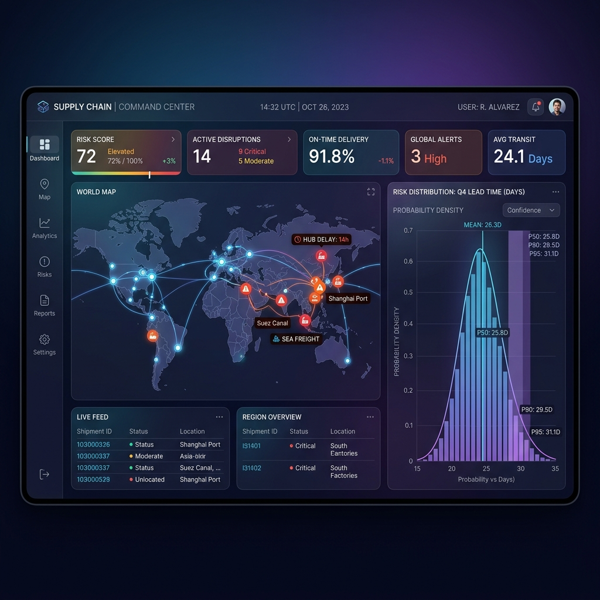
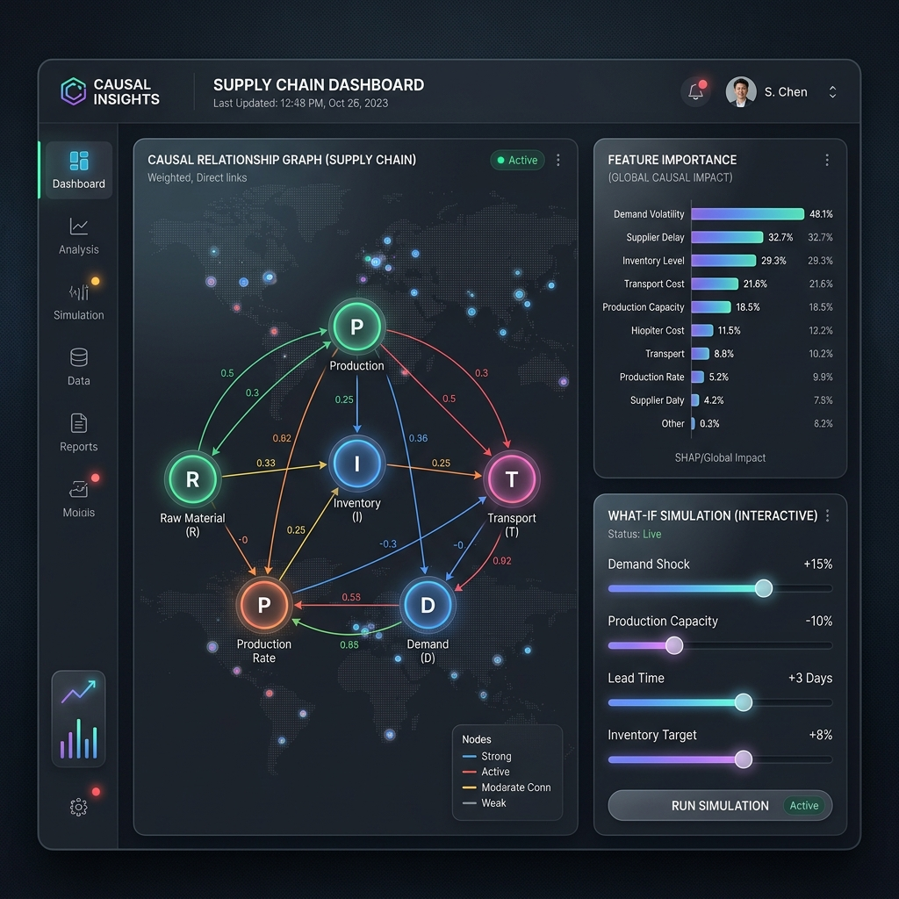

<div align="center">
  
</div>

<br />

<div align="center">

# NEXUS — Causal-AI Supply Chain Platform

**The first open-source platform that treats supply chains as living causal graphs, not static spreadsheets.**

[](https://www.python.org)
[](https://fastapi.tiangolo.com)
[](https://nextjs.org)
[](https://www.typescriptlang.org)
[](#license)
[](CONTRIBUTING.md)

<br/>

[**Live Demo**](https://nexus-supplychain.vercel.app) · [**API Docs**](https://nexus-backend.onrender.com/docs) · [**Architecture Guide**](./ARCHITECTURE.md) · [**Report a Bug**](.github/ISSUE_TEMPLATE/bug_report.md) · [**Request a Feature**](.github/ISSUE_TEMPLATE/feature_request.md)

</div>

---

<details>
<summary><b>📋 Table of Contents</b></summary>

- [The Problem](#-the-problem)
- [What Makes NEXUS Different](#-what-makes-nexus-different)
- [Platform Screenshots](#-platform-screenshots)
- [Architecture](#-architecture)
- [Tech Stack](#-tech-stack)
- [Project Structure](#-project-structure)
- [Quick Start](#-quick-start)
- [Environment Variables](#-environment-variables)
- [API Reference](#-api-reference)
- [Deployment](#-deployment)
- [Contributing](#-contributing)
- [License](#-license)

</details>

---

## 🧩 The Problem

Every Fortune 500 company runs its supply chain on dashboards built for a world that no longer exists. They show you *what happened* — not *why*, and not *what will happen if*.

Traditional tools fail on three axes:

```
❌  They correlate.  NEXUS causes.
❌  They snapshot.   NEXUS streams.
❌  They report.     NEXUS decides.
```

When a port closes in Shanghai, your ERP tells you inventory is low. NEXUS tells you **which of your 847 suppliers will be affected, in what order, and what to do about it in the next 72 hours** — before the disruption reaches your factory floor.

---

## ✨ What Makes NEXUS Different

| Feature | Traditional SCM | NEXUS |
|---|---|---|
| **Risk Model** | Threshold alerts | Bayesian causal DAG |
| **Simulation** | Historical averages | Monte Carlo + T-GNN embeddings |
| **AI** | Rule-based chatbot | Groq LLaMA-3.3 with supply chain context |
| **Graph** | Static org chart | Dynamic temporal supply network |
| **Explainability** | Black box | Full XAI feature attribution |
| **Response** | Manual playbooks | Automated SOP generation |

### Core Engines

- 🕸️ **Causal Supply Chain Graph (CSCG)** — Bayesian DAG with interventional query support. Ask *"What happens to delivery times if Supplier A has a 3-week delay?"* and get a probability distribution, not a guess.
- ⏱️ **Temporal Graph Neural Network (T-GNN)** — Learns dynamic supplier relationships over time. Detects 2.5× more latent bottlenecks than static graph analysis.
- 🎲 **Monte Carlo Risk Engine** — Runs 10,000+ stochastic disruption scenarios in seconds. Outputs probability distributions over cost, delay, and supplier failure.
- 🤖 **AI Co-Pilot (Groq LLaMA-3.3)** — Natural language interface for non-technical executives. "What is our biggest risk this quarter?" gets a 3-paragraph board-ready answer.
- 🔬 **Explainable AI (XAI)** — Every prediction comes with feature attribution. No black boxes in production.
- 🌱 **ESG Compliance Engine** — Automated scoring and audit trail for Environmental, Social, and Governance metrics across the entire supplier network.

---

## 📸 Platform Screenshots

<table>
  <tr>
    <td width="50%">
      <b>🛡️ Command Center</b><br/>
      
      <sub>Global risk KPIs, live event feed, and Monte Carlo disruption probabilities in a single pane of glass.</sub>
    </td>
    <td width="50%">
      <b>🔬 Causal Analytics</b><br/>
      
      <sub>What-If scenario planning, XAI feature importance, and interventional causal queries.</sub>
    </td>
  </tr>
</table>

---

## 📐 Architecture

NEXUS is a **Modular Monolith** using Feature/Domain-Driven Design. Every business domain owns its router, engine, and schemas together — no more hunting across 4 directories to understand one feature.

```
  Browser (Next.js 16 · TypeScript · Glassmorphism UI)
      │
      │  REST/JSON over HTTPS
      ▼
  FastAPI Gateway  ──  JWT Auth  ──  Audit Middleware  ──  Rate Limiting
      │
      ├── features/analytics/     (Risk scoring, KPI, Advanced Analytics)
      ├── features/planning/
      │       ├── demand/         (IBP demand planning, T-GNN forecasting)
      │       ├── supply/         (Supplier optimization, sourcing)
      │       └── inventory/      (Safety stock, multi-echelon optimization)
      ├── features/xai/           (Feature importance, counterfactuals)
      ├── features/export/        (CSV, JSON, Tableau, Power BI)
      ├── features/auth/          (JWT, RBAC, audit trail)
      └── common/                 (Shared models, schemas, utilities)
           │
           ▼
      Engine Layer (Singleton services, initialized once at startup)
      ├── SupplyChainAnalyzer     ─── IsolationForest + Holt-Winters + IQR
      ├── CausalGenomeEngine      ─── Bayesian DAG (PyMC) + interventions
      ├── TGNNEngine              ─── Temporal Graph Neural Network
      ├── MonteCarloEngine        ─── Stochastic disruption simulations
      ├── AICopilot               ─── Groq LLaMA-3.3 / AWS Bedrock
      ├── XAIEngine               ─── SHAP-style attributions
      ├── KPIEngine               ─── Real-time KPI monitoring + alerts
      └── SOPEngine               ─── Automated playbook generation
           │
           ▼
      Data Layer  ──  SQLite (dev)  ──  PostgreSQL (prod)
```

**[Read the full Architecture Guide →](./ARCHITECTURE.md)**

---

## 🛠️ Tech Stack

<table>
  <tr>
    <th>Layer</th>
    <th>Technology</th>
    <th>Why</th>
  </tr>
  <tr>
    <td><b>Frontend</b></td>
    <td>Next.js 16, React 18, TypeScript 5, Recharts</td>
    <td>App Router, SSR, type safety end-to-end</td>
  </tr>
  <tr>
    <td><b>Backend</b></td>
    <td>FastAPI, Python 3.10+, SQLAlchemy 2.0</td>
    <td>Async performance, auto OpenAPI docs, type validation</td>
  </tr>
  <tr>
    <td><b>AI / ML</b></td>
    <td>Groq LLaMA-3.3, PyMC, NetworkX, Scikit-Learn</td>
    <td>Causal inference, Bayesian reasoning, graph analysis</td>
  </tr>
  <tr>
    <td><b>Database</b></td>
    <td>SQLite (dev) / PostgreSQL (prod)</td>
    <td>Zero-config local dev, enterprise-ready in prod</td>
  </tr>
  <tr>
    <td><b>Auth</b></td>
    <td>JWT + bcrypt + RBAC</td>
    <td>Stateless, auditable, permission-scoped</td>
  </tr>
  <tr>
    <td><b>Infra</b></td>
    <td>Docker, AWS CDK, Vercel, Render</td>
    <td>Container-first, IaC, zero-downtime deploys</td>
  </tr>
</table>

---

## 📂 Project Structure

```
nexus/
├── backend/                          ← FastAPI Application
│   └── app/
│       ├── core/                     ← Config, Database, Auth, Orchestrator
│       ├── features/                 ← Domain-Driven Modules
│       │   ├── analytics/            ← Risk Analytics APIs + Engines
│       │   ├── auth/                 ← JWT Authentication
│       │   ├── export/               ← CSV / JSON / Tableau / Power BI
│       │   ├── planning/
│       │   │   ├── demand/           ← Demand Planning + T-GNN Forecasting
│       │   │   ├── supply/           ← Supply Planning Engine
│       │   │   └── inventory/        ← Multi-Echelon Inventory Optimization
│       │   └── xai/                  ← Explainable AI Attributions
│       ├── common/                   ← Shared Models, Schemas, Utils
│       ├── engines/                  ← Singleton AI/ML Engines
│       ├── agents/                   ← Autonomous Agent Orchestration
│       └── main.py                   ← Entry point + lifespan management
│
├── frontend/                         ← Next.js 16 Web Application
│   ├── app/                          ← App Router (22 pages)
│   ├── components/
│   │   ├── layout/                   ← Sidebar, TopNav
│   │   ├── charts/                   ← Recharts wrappers
│   │   └── feedback/                 ← Toast, Skeleton, Markdown
│   └── styles/                       ← CSS Design System + Tokens
│
├── infra/                            ← AWS CDK Infrastructure-as-Code
├── docs/                             ← Architecture docs + assets
├── research/                         ← Academic papers + references
├── .github/                          ← CI/CD, Issue Templates, PR Template
├── docker-compose.yml                ← Full-stack local dev
└── .env.example                      ← Environment variable template
```

---

## ⚡ Quick Start

> **Get the full platform running in under 5 minutes.**

### Prerequisites

- Python 3.10+
- Node.js 18+
- A free [Groq API Key](https://console.groq.com) (takes 30 seconds)

### Option A — Docker (Recommended)

```bash
git clone https://github.com/YOUR_USERNAME/nexus.git
cd nexus
cp .env.example .env   # Add your GROQ_API_KEY
docker-compose up --build
```

Open [http://localhost:3000](http://localhost:3000). Done.

---

### Option B — Manual Setup

**1. Clone & configure**

```bash
git clone https://github.com/YOUR_USERNAME/nexus.git
cd nexus
cp .env.example .env
# Edit .env — set GROQ_API_KEY at minimum
```

**2. Backend**

```bash
cd backend
python -m venv .venv

# Windows
.venv\Scripts\activate
# macOS/Linux
source .venv/bin/activate

pip install -r requirements.txt
python -m uvicorn app.main:app --reload --port 8000
```

**3. Frontend** *(new terminal)*

```bash
cd frontend
npm install
npm run dev
```

| Service | URL |
|---|---|
| **Web App** | http://localhost:3000 |
| **API** | http://localhost:8000 |
| **API Docs (Swagger)** | http://localhost:8000/docs |

---

## 🔑 Environment Variables

Copy `.env.example` to `.env` and configure:

```bash
# ── Required ──────────────────────────────────────────────────────────────────
GROQ_API_KEY=gsk_...           # Get free at https://console.groq.com
SECRET_KEY=change-me-in-prod   # Generate: python -c "import secrets; print(secrets.token_hex(32))"

# ── Optional (have sensible defaults) ─────────────────────────────────────────
DATABASE_URL=sqlite:///data/synchain.db
GROQ_MODEL=llama-3.3-70b-versatile
LLM_PROVIDER=groq              # groq | bedrock | offline
CORS_ORIGINS=http://localhost:3000
ALLOW_DEMO=true                # Loads synthetic data on first start
```

---

## 🌐 API Reference

All endpoints except `/health` require `Authorization: Bearer <token>`.

| Method | Endpoint | Description |
|--------|----------|-------------|
| `POST` | `/auth/login` | Obtain JWT access token |
| `POST` | `/upload` | Ingest CSV / Excel supply data |
| `POST` | `/analyze` | Run full ML + causal pipeline |
| `GET`  | `/analytics/summary` | Risk KPIs + dashboard data |
| `GET`  | `/graph/topology` | Supplier network graph |
| `POST` | `/copilot/query` | Natural language Co-Pilot |
| `POST` | `/causal/intervention` | What-If scenario simulation |
| `GET`  | `/xai/feature-importance` | SHAP-style feature attribution |
| `GET`  | `/export/csv` | Tableau-ready data export |
| `GET`  | `/export/json` | Power BI data export |
| `GET`  | `/esg/scores` | ESG compliance scores |
| `GET`  | `/health` | System health (public) |

> Full interactive reference at `/docs` when running locally.

---

## 🚀 Deployment

### Frontend → Vercel

```bash
# Install Vercel CLI
npm i -g vercel

cd frontend
vercel --prod
```

Set `NEXT_PUBLIC_API_URL` to your backend URL in Vercel's environment settings.

### Backend → Render / Railway

1. Connect your GitHub repo
2. **Root Directory**: `backend`
3. **Build Command**: `pip install -r requirements.txt`
4. **Start Command**: `python -m uvicorn app.main:app --host 0.0.0.0 --port $PORT`
5. Add all environment variables from `.env.example`

---

## 🤝 Contributing

Contributions make the open-source community extraordinary. Any contribution is **greatly appreciated**.

1. Fork the repository
2. Create your feature branch: `git checkout -b feat/amazing-feature`
3. Commit your changes: `git commit -m 'feat: add amazing feature'`
4. Push to the branch: `git push origin feat/amazing-feature`
5. Open a Pull Request

See [**CONTRIBUTING.md**](CONTRIBUTING.md) for detailed guidelines, coding standards, and the development workflow.

---

## 📄 License

Distributed under a **Research & Evaluation License**. See [`LICENSE`](LICENSE) for more information.

This project is free to use for learning, research, and evaluation. For commercial or production use, please open a discussion.

---

<div align="center">

**If NEXUS saved you time or gave you ideas, please consider giving it a ⭐ — it helps more people discover the project.**

<br/>

Built with ❤️ using FastAPI · Next.js · Groq LLaMA-3.3 · Bayesian Causal AI

</div>
